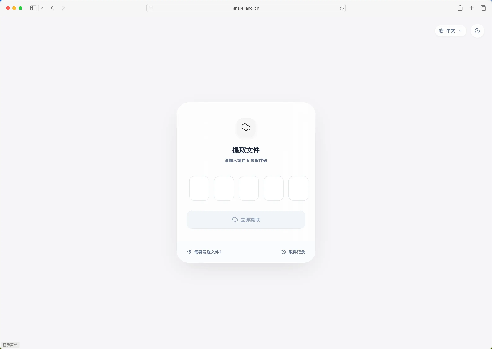

<div align="center">



<p><em>Share text and files anonymously with a passcode, like picking up a package</em></p>

[](https://github.com/su-jiner/ShowFileCloud/stargazers)
[](https://github.com/su-jiner/ShowFileCloud/network)
[](https://github.com/su-jiner/ShowFileCloud/issues)
[](https://github.com/su-jiner/ShowFileCloud/blob/master/LICENSE)

</div>

## Introduction

ShowFileCloud is a lightweight file sharing tool developed with FastAPI + Vue3. It lets users share text and files
easily, where recipients only need a passcode to retrieve the files, just like picking up a package from a locker.

- 🚀 Quick deployment: one-command Docker deployment
- 🔒 Secure by default: files are protected by retrieval codes
- ⏱️ Flexible expiry: expire by time or retrieval count
- 🗂️ Multiple storage backends: local, S3, OneDrive, WebDAV, and OpenDAL
- 📱 Responsive design: works on mobile and desktop

## Quick Start

### Docker Deployment (recommended)

```bash
docker run -d --restart unless-stopped \
  -p 12345:12345 \
  -v sfc-data:/app/data \
  -e APP_ENV=production \
  -e LOG_LEVEL=warning \
  --log-opt max-size=10m \
  --log-opt max-file=3 \
  --name showfilecloud \
  su-jiner/showfilecloud:2.7.1 # x-release-please-version
```

Open `http://localhost:12345` and complete the first-run setup.

### Docker Compose

```bash
docker compose up -d
```

### Manual Deployment

```bash
git clone https://github.com/su-jiner/ShowFileCloud.git
cd ShowFileCloud
pip install -r requirements.txt
python main.py
```

## Documentation

Full usage, configuration, and API documentation lives in [`docs/`](docs/en/index.md), or visit the online docs site.

## Project Layout

```
ShowFileCloud/
├── apps/           # Application code
│   ├── admin/      # Admin panel
│   └── base/       # Core features
├── core/           # Core modules
├── data/           # Data directory
├── docs/           # VitePress documentation
└── sfc-fronted/    # Frontend source (fetched from GitHub at image build time)
```

## Contributing

1. Fork this project
2. Create a branch: `git checkout -b feature/xxx`
3. Commit your changes: `git commit -m 'Add xxx'`
4. Push the branch: `git push origin feature/xxx`
5. Open a Pull Request

## Disclaimer

This project is open-source for learning purposes only. It should not be used for any illegal purposes.
The author is not responsible for any consequences. Please retain the project address and copyright information when using it.